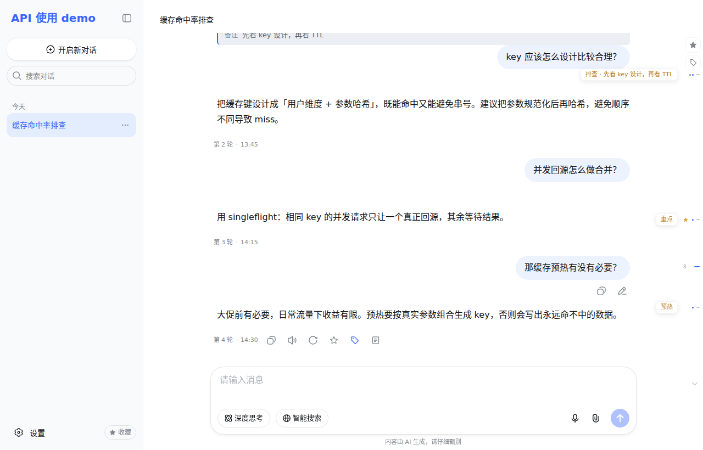
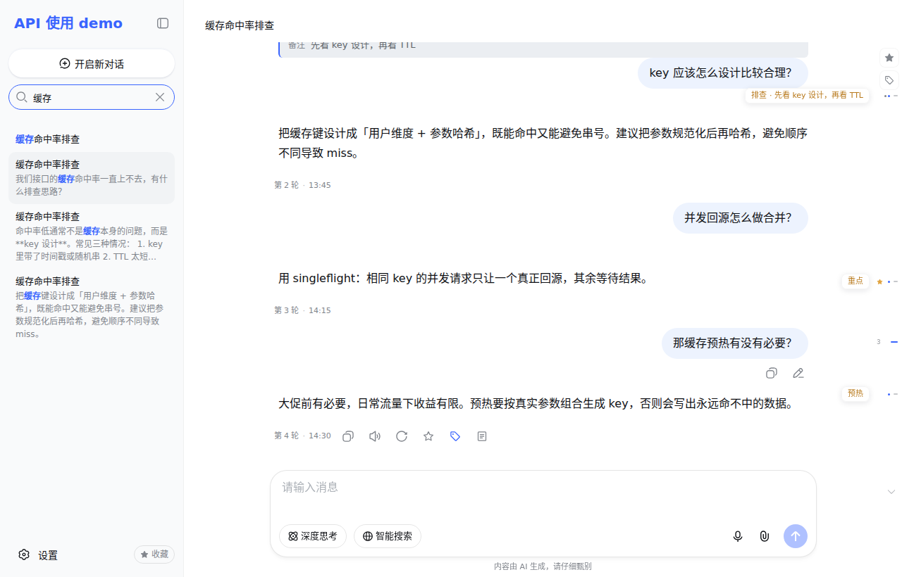
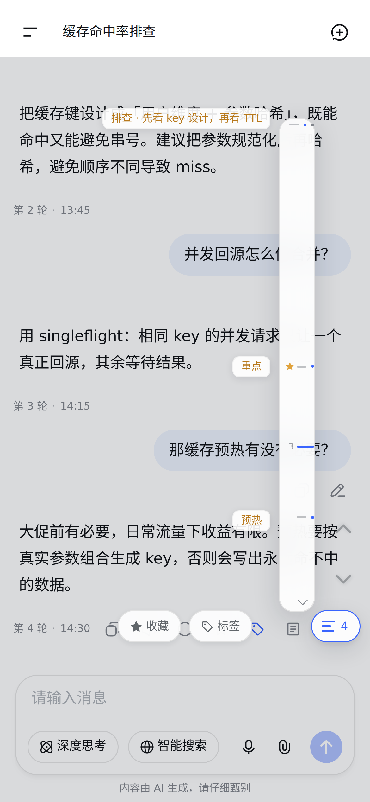
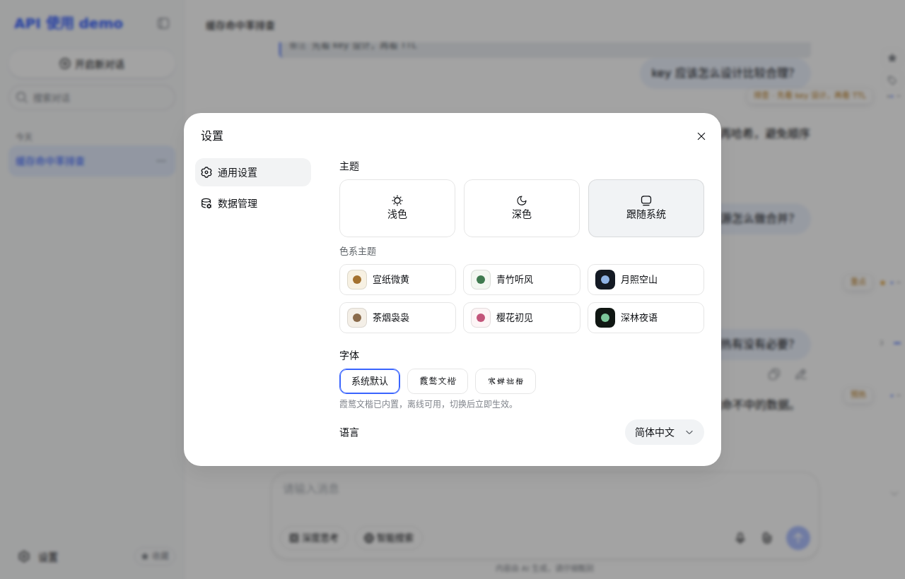

# chat-demo (enhanced fork)

English | [简体中文](README.zh-CN.md)

A static chat client for the DeepSeek API, forked from [deepseek-ai/chat-demo](https://github.com/deepseek-ai/chat-demo). There is no application backend: the browser talks to the API directly and keeps everything in IndexedDB.

This fork adds the three things that matter most in daily use: **multi-device sync**, **better reading and retrieval for long conversations**, and **a more comfortable UI**.



## What's new

### 1. Multi-device sync (LAN or your own server)

Phone and desktop point at the same address and conversations plus images sync automatically — no more manual ZIP export/import.

- A zero-dependency sync server ships in `server/sync-server.mjs`: one Node process, one directory
- **Per-conversation deltas**: only the changed conversation is uploaded, attachments once
- Last-write-wins per conversation; deletions propagate as tombstones; importing a ZIP pushes the new conversations to other devices
- Optional access token; works on a LAN or behind a reverse proxy on a domain
- Don't want our server? [server/README.md](server/README.md) documents the small HTTP contract, so S3, object storage, or your own implementation in any language is a drop-in replacement

### 2. Reading long conversations

| Feature | Description |
| --- | --- |
| Round rail | One tick per round on the right edge; hover to preview the question, click to jump; jump-to-latest button at the bottom |
| Star / tag / note | Both conversations and individual answers can be marked; the rail shows tags and notes as a gold outline |
| Round navigation | Every third round is numbered; mobile gets previous/next round buttons |
| Filters | Sidebar filters by favorites or tag; inside a conversation, the rail can show only starred rounds |
| Pin | Pinned conversations stay on top of the list |
| Full-text search | Search titles and message bodies, highlighted matches, click to jump to the message |
| Code folding | Blocks over 10 lines collapse by default; copy always copies the full code |
| Thinking folding | Historical thinking is collapsed; new answers collapse it as soon as thinking ends |

<table>
<tr>
<td></td>
<td></td>
</tr>
</table>

### 3. Appearance

- Six color themes: Rice Paper, Bamboo Breeze, Moonlit Mountain, Tea Smoke, First Sakura, Deep Forest Night
- Two bundled Chinese fonts: LXGW WenKai and ChillZhuoKai (both SIL OFL, work offline)
- Round number and time under every answer; the last scroll position is restored



## Getting started

Requires Node.js 22.12+ and pnpm:

```sh
git clone <this repo>
cd chat-demo
pnpm install
pnpm dev            # http://localhost:8090
```

Build the static site:

```sh
pnpm build          # output in dist/, serve it with any static server
```

Enter your DeepSeek API key in Settings on first use. The key stays in browser localStorage and requests go straight to `https://api.deepseek.com`.

## Sync server

```sh
# on an always-on machine (Node 22+, no dependencies)
pnpm sync           # listens on 0.0.0.0:8787, data in server/.sync-data/
```

Then on every device open **Settings → Data → Sync across devices** and fill in:

- Address: `http://<server-ip>:8787` (or the domain you proxied)
- Access token: the same value as the server's `SYNC_TOKEN`, if set

Docker, systemd, HTTPS reverse proxy, tokens, and storage alternatives are documented in [server/README.md](server/README.md).

## Deployment

- Static hosting: `pnpm build` and serve `dist/`; see [docs/deploy.md](docs/deploy.md) for nginx and systemd examples
- GitHub Pages: the bundled [workflow](.github/workflows/pages.yml) publishes a demo (UI only — sync needs your own server)

## Data and privacy

- Conversations and attachments live in IndexedDB; the API key lives in localStorage
- Nothing leaves the browser until you enable sync, and then it only goes to your own sync server
- Voice input and read-aloud need a secure context (HTTPS); plain HTTP disables the microphone

## Contributing

Issues and pull requests are welcome — see [CONTRIBUTING.md](CONTRIBUTING.md) for the dev setup, project layout, and the checks to run before opening a PR.

## License

Code under the upstream [MIT](LICENSE) license.

Bundled fonts:

- LXGW WenKai — SIL OFL 1.1, see `src/assets/fonts/lxgw-wenkai/OFL.txt`
- ChillZhuoKai — SIL OFL 1.1, see `src/assets/fonts/chill-zhuokai/OFL.txt`

The original project is copyright DeepSeek; changes in this fork are released under the same MIT license.
