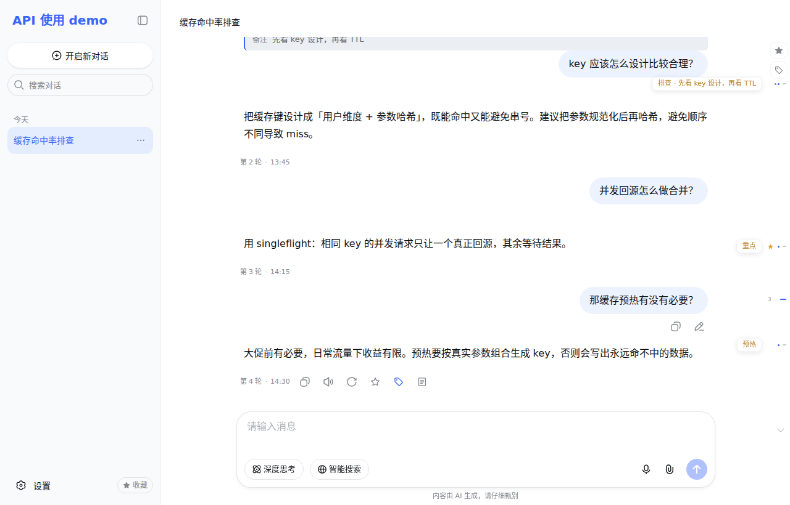
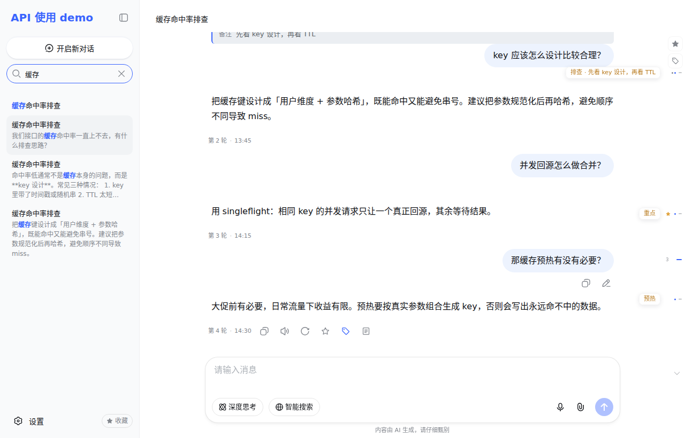
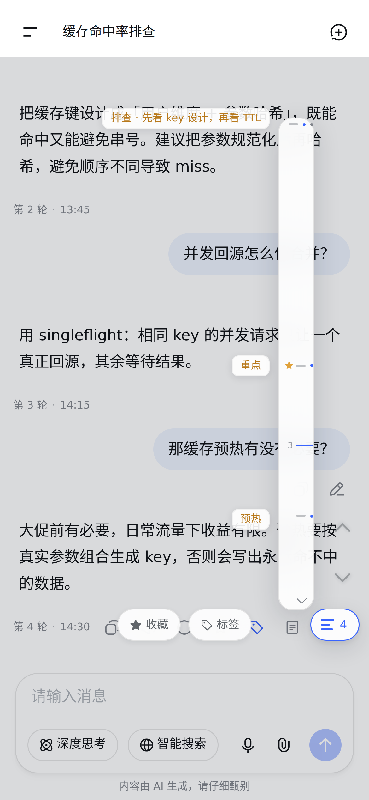
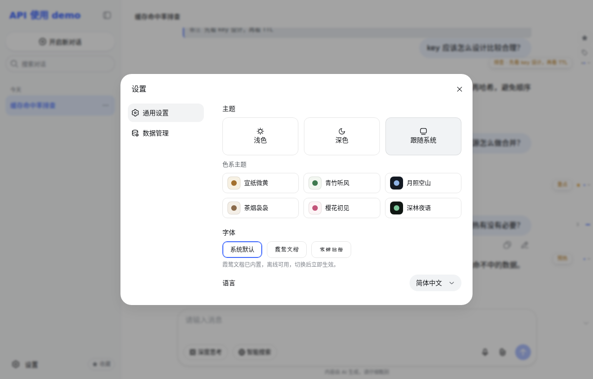

# chat-demo（增强版）

[English](README.md) | 简体中文

基于 [deepseek-ai/chat-demo](https://github.com/deepseek-ai/chat-demo) 改造的静态聊天客户端。没有应用后端：浏览器直连 DeepSeek API，数据存在本地 IndexedDB。

这个分支补了三件最影响日常使用的事：**多设备同步**、**长会话的阅读与检索**、**更舒服的界面**。



## 相比原版新增

### 1. 局域网 / 自建服务器多设备同步

手机和电脑填同一个地址就能互相同步会话和图片，不用再手动导出 ZIP。

- 自带零依赖的同步服务（`server/sync-server.mjs`）：一个 Node 进程、一个目录就是全部
- **按会话增量同步**：改哪个会话只传哪个，附件只传一次
- 会话级最后写入优先；删除会同步墓碑；导入 ZIP 后自动把新增会话推给其他设备
- 支持访问令牌，可以只跑在局域网，也可以反代到公网域名
- 不想用自带服务也行：[server/README.md](server/README.md) 写清了只有几个接口的 HTTP 协议，换成 S3、对象存储或用任何语言重写都可以

### 2. 长会话阅读增强

| 功能 | 说明 |
| --- | --- |
| 轮次刻度尺 | 右侧每轮一个刻度，悬停看提问，点击跳转；底部有「回到文末」 |
| 收藏 / 标签 / 备注 | 会话和单条回答都能标记；刻度尺左侧把标签和备注显示成金色提纲 |
| 轮次导航 | 刻度尺上每 3 轮标注序号；手机端有上一轮 / 下一轮按钮 |
| 筛选 | 会话列表按「只看收藏」或标签筛选；单个会话内也能只看收藏过的轮次 |
| 会话置顶 | 重要会话固定在列表顶部，不随时间下沉 |
| 全文搜索 | 侧边栏搜标题和消息正文，命中词高亮，点结果直接跳到那条消息 |
| 代码块折叠 | 超过 10 行默认收起，按钮展开；复制始终是完整代码 |
| 思考折叠 | 历史消息的思考过程默认收起；新回答思考结束自动收起 |

<table>
<tr>
<td></td>
<td></td>
</tr>
</table>

### 3. 界面

- 内置 6 个色系主题：宣纸微黄、青竹听风、月照空山、茶烟袅袅、樱花初见、深林夜语
- 内置两套中文字体：霞鹜文楷、寒蝉拙楷（都是 OFL 协议，离线可用）
- 每条回答下方常显轮次编号与提问时间；恢复上次滚动位置



## 快速开始

需要 Node.js 22.12+ 和 pnpm：

```sh
git clone <本仓库>
cd chat-demo
pnpm install
pnpm dev            # http://localhost:8090
```

打包成静态站点：

```sh
pnpm build          # 产物在 dist/，可直接用 nginx 托管
```

首次打开在设置里填 DeepSeek API Key。Key 只存在浏览器 localStorage，请求直接从浏览器发往 `https://api.deepseek.com`。

## 多设备同步

```sh
# 在一台常开的机器上（Node 22+，零依赖）
pnpm sync           # 默认监听 0.0.0.0:8787，数据在 server/.sync-data/
```

然后在每台设备的 **设置 → 数据管理 → 多设备同步** 里填：

- 同步地址：`http://<服务器 IP>:8787`（或你反代出来的域名）
- 访问令牌：服务端设置了 `SYNC_TOKEN` 时填同一个值

Docker、systemd、HTTPS 反代、令牌和替代存储方案见 [server/README.md](server/README.md)。

## 部署

- 静态托管：`pnpm build` 后把 `dist/` 交给任何静态服务器，[docs/deploy.md](docs/deploy.md) 有 nginx / systemd 示例
- GitHub Pages：仓库自带 [workflow](.github/workflows/pages.yml)，推 tag 或在 Actions 里手动触发即可发布演示站（同步功能不可用，纯前端演示）

## 数据与隐私

- 会话和附件存在浏览器 IndexedDB，API Key 存在 localStorage，不经过第三方服务器
- 只有开启同步后，会话内容才会发到你自己搭的同步服务；服务端就是一个目录，备份打包即可
- 语音输入 / 朗读需要 HTTPS（安全上下文），HTTP 下浏览器会禁用麦克风

## 参与贡献

欢迎提 Issue 和 PR，开发环境、目录结构、提交前要跑的检查都写在 [CONTRIBUTING.md](CONTRIBUTING.md) 里。

## 许可证

代码沿用上游的 [MIT](LICENSE)。

内置字体的授权：

- 霞鹜文楷（LXGW WenKai）：SIL OFL 1.1，见 `src/assets/fonts/lxgw-wenkai/OFL.txt`
- 寒蝉拙楷（ChillZhuoKai）：SIL OFL 1.1，见 `src/assets/fonts/chill-zhuokai/OFL.txt`

原项目版权归 DeepSeek 所有，本分支的改动同样以 MIT 发布。
